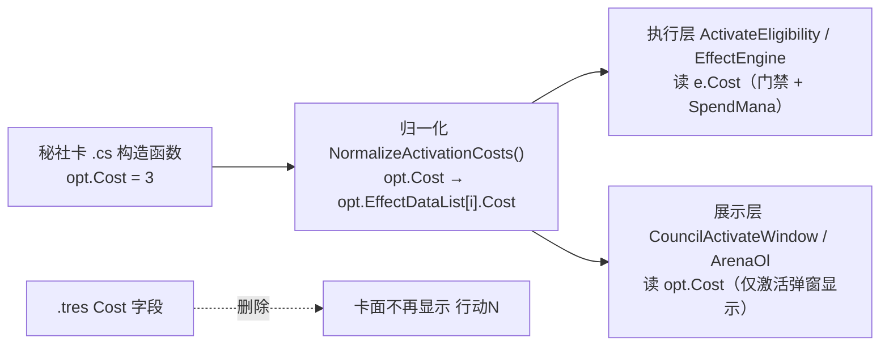

## 产品概述

对秘社卡模组（`Cards/Data/CouncilCards/JC/`，17 个 `.tres`）做一轮"字段瘦身 + 费用权责归一"改造：把已经迁移到效果系统（EffectData / ActivationOptions）的静态卡面字段从 `.tres` 中移除，让秘社卡的"能力表达"只保留在效果系统一处，避免双轨数据脱节。

## 核心功能（四项改造）

1. **移除 `PT`**：PT 的语义实际就是起始手牌，与 `StartingHandSize` 重复（MSJC009 测试已改为 7，由 `StartingHandSize = 7` 承载）。需说明移除后对现有逻辑与已落地卡牌效果的影响。

2. **移除 `TableRow`**：全部 17 张恒为 2，无任何运行时消费。需说明移除后 UI 显示、数据结构（JSON 导出契约）、读取流程分别受何影响。

3. **`Cost` 完全交由效果系统决定**：
   - `.tres` 的 `Cost` 若无人引用则一并移除；
   - UI 卡面不再显示费用；
   - 费用仅在"激活效果时"显示；
   - 激活效果的费用统一读取 `ActivationOptions[i].Cost`。
   - 需详述对现有 Cost 的读取、显示、校验、激活四条链路的影响。

4. **"需先手标志才能使用"改由效果系统判定**：
   - 判据已在 `EffectData.Condition.Predicate = "具有先手标志"`；
   - `.tres` 中体现这部分卡面信息的 `RelatedCardUID = "TK007"` 一并移除；
   - 前提是不影响 MSJC001 / MSJC009 / MSJC017 等已落地的先手标志效果。

## 重点交付

- 17 个 `.tres` 的**具体修改步骤**（逐字段、含 MSJC009 无 Restrictions、MSJC012 缺 RelatedCardUID 等特例）；
- **每项修改的风险评估**；
- **对现有效果的兼容性影响**；
- **建议的验证方式**。


## 技术栈

- Godot 4 C#（.NET 8），`.tres` 资源 + `[Export]` 属性自动映射；`Cards/Script/CouncilCards/JC/*.cs` 为各秘社卡子类（继承 `CouncilCardData : BaseCardData : Resource`）。
- 秘社能力由 `.cs` 构造函数填充 `ActivationOptions` / `EffectDataList`（`EffectData` 为 `RefCounted`，不可序列化进 `.tres`）。
- 导出链：`CouncilCardData → CardTresToJson → CardTemplateData → Cards/card_templates.json`（纯托管 POCO，`CardManager` 中暂无实际装载路径，仅注释提及）。

## 实现方案总览

采用"**先扫消费点 → 再删字段 → 后归一费用 → 最后修脚本/测试/文档**"的顺序，每一步都可独立验证。核心原则是：**凡是被效果系统接管的静态字段一律从 `.tres` 退场；执行链只保留一个费用真值源**。

### 关键现状（已实地核查，决定方案取舍）

| 字段 | 生产代码消费点 | 结论 |
|---|---|---|
| `PT` | 仅 `CouncilCardUI.cs:175` 拼 `"PT {data.PT}"`；`CardTresToJson.cs:109` 导出；测试 `CouncilEffectTests.cs:63` | 纯展示，无战斗/构筑/结算逻辑 |
| `TableRow` | 仅 `CardTresToJson.cs:111` 导出；`CardTemplateData.cs:85` 字段 | 无 UI、无布局消费（排版走 `CardLayoutHelper.LayoutCardsEvenly`） |
| `CouncilCardData.Cost` | 仅 `CouncilCardUI.cs:178-179` 卡面 `"行动N"`；`CardTresToJson.cs:113` 导出 | **不参与门禁、不参与扣费** |
| `RelatedCardUID` | 仅 `CardTresToJson.cs:110` 导出；测试 `CouncilEffectTests.cs:64` | 无功能读取 |
| `ActivationOptions[i].Cost` | **全项目 `opt.Cost` 命中 0 次**（生产代码从未读取） | 只被测试断言，当前是"死数据" |

费用**真正被读取**的位置（均为 `EffectData.Cost`）：
- `ActivateEligibility.cs:111`（候选枚举·秘社分支）
- `ActivateEligibility.cs:310`（`CanActivateCouncil` 门禁）
- `EffectEngine.ActivateAbility`（扣费 `SpendMana`）
- 打出路径 `TurnManager.cs:3489-3528` 读的是 `PlayerCardData.Cost`，与秘社激活是**两条独立链路**，不受本次改动影响。

### 决策一：Cost 采用"opt.Cost 为声明源、e.Cost 为执行源、构造后归一化"

不把门禁直接改成读 `opt.Cost`（会引入"选项 N 个 EffectData 各不同费用"的歧义），而是：



即：`opt.Cost` 是**唯一人工维护点**，`e.Cost` 由它派生，二者永不脱节；执行层继续读 `e.Cost`（无需改动门禁逻辑，零回归风险），展示层读 `opt.Cost`。这样"激活效果的费用统一读取 `ActivationOptions[i].Cost`"在语义上完全成立。

### 决策二：UI 节点保守处理

`.tscn` 中 `Display/PTLabel`、`Display/CostLabel` 建议**连同节点一并删除**（`node_paths` 同步移除），避免留下无人赋值的空 Label；若担心场景改动引入风险，可退一步保留节点但移除 `[Export]` 与赋值。推荐前者（项目已有"避免 `.tscn` 与字段不同步"的既有纪律，见 `DeckBuilder` 注释）。

### 决策三：`_gen_restrictions.py` 锚点必须先改

该脚本用 `(\nCost = -?\d+\n)` 定位并在其后插入 `Restrictions = ...`（服务 MSJC010~017）。**删除 `Cost` 行后脚本将静默失效**（幂等清理还能跑，但插入不到锚点 → Restrictions 丢失）。必须在删除 TRES 字段的**同一批次内**把锚点改为 `(\nOrganization = "[^"]*"\n)`。

## 目录结构与修改文件清单

```
d:/MYPROJECT/UWPro/
├── Cards/Data/CouncilCards/JC/
│   ├── MSJC001_weimushouwang.tres        # [MODIFY] 删 PT / TableRow / Cost / RelatedCardUID
│   ├── MSJC002_liemoren.tres             # [MODIFY] 同上
│   ├── MSJC003_wangzuohui.tres           # [MODIFY] 同上
│   ├── MSJC004_mingzhongjiaopai.tres     # [MODIFY] 同上
│   ├── MSJC005_guojiajigou.tres          # [MODIFY] 同上
│   ├── MSJC006_shengxian.tres            # [MODIFY] 同上
│   ├── MSJC007_fangbeixulie.tres         # [MODIFY] 同上
│   ├── MSJC008_mengjingxingzhe.tres      # [MODIFY] 同上
│   ├── MSJC009_mishe.tres                # [MODIFY] 同上（特例：无 Restrictions 行；StartingHandSize=7 保留）
│   ├── MSJC010_mozu.tres                 # [MODIFY] 同上
│   ├── MSJC011_SPTzhixingbu.tres         # [MODIFY] 同上
│   ├── MSJC012_aifuluodejiazu.tres       # [MODIFY] 删 PT / TableRow / Cost（本就无 RelatedCardUID）
│   ├── MSJC013_jishizhe.tres             # [MODIFY] 同上（014~017 同）
│   ├── MSJC014_shaobing.tres             # [MODIFY]
│   ├── MSJC015_yinshi.tres               # [MODIFY]
│   ├── MSJC016_songwangzhe.tres          # [MODIFY]（PT="5"、StartingHandSize=5 保留）
│   └── MSJC017_mengyanzuqun.tres         # [MODIFY]
├── Script/Data/Cards/
│   ├── CouncilCardData.cs                # [MODIFY] 删 PT/RelatedCardUID/TableRow/Cost 四个 [Export]；新增归一化方法
│   └── CouncilActivationOption.cs        # [MODIFY] Cost 注释补"唯一声明源"语义（默认 0 保持）
├── Script/Net/CardTemplateData.cs        # [MODIFY] 删 Council 专有 PT / RelatedCardUID / TableRow
│                                         #   ⚠ 通用 Cost（第 37 行，玩家卡共用）必须保留
├── Script/Tools/CardTresToJson.cs        # [MODIFY] 删 109/110/111/113 四行赋值
├── Script/UI/
│   ├── CouncilCardUI.cs                  # [MODIFY] 删 PT/Cost 标签赋值 + SetFace + ClearLabels + [Export]
│   ├── CouncilActivateWindow.cs          # [MODIFY] 按钮文案显示费用（读 opt.Cost）
│   ├── ArenaOl.cs                        # [MODIFY] 联机选项标签显示费用（约 1949-1951 行）
│   └── DeckBuilder.cs                    # [不改] CostText 只接 PlayerCardData，与秘社无关
├── Scenes/UI/CouncilCardUI.tscn          # [MODIFY] 移除 _ptLabel/_costLabel 的 node_paths 与两个 Label 节点
├── Script/Manager/ActivateEligibility.cs # [MODIFY] 仅补注释标明 e.Cost 来源（111/310 行逻辑不动）
├── Script/Tests/CouncilEffectTests.cs    # [MODIFY] 删 63(PT)/64(RelatedCardUID) 断言；72-73 选项 Cost 断言保留
├── _gen_restrictions.py                  # [MODIFY] 插入锚点 Cost → Organization（:2 注释 + :73-75 正则）
└── 秘社卡TRES字段修正对照.md / JC卡牌效果实现清单.md / 秘社制作交接提示词.md / 需求实现对照.md   # [MODIFY] 同步字段口径
```

## 执行细节（防止回归）

1. **`.tres` 编辑纪律**：只删目标四行，不重排字段、不改缩进；保留原 CRLF/LF；写文件用 `UTF8Encoding(false)`（无 BOM）；`[resource]` 段内其余行（CardText / CardImagePath / StartingHandSize / SubType / Colors / Organization / Restrictions / UID / CardName / metadata）一律不动。
2. **删除后自检**：每张文件删除后应仍能被 `ResourceLoader.Load<CouncilCardData>` 加载，且 `Restrictions.Count` 与删除前一致（001~008=1、009=0、010~017=1）。
3. **`CardTemplateData.Cost` 是通用字段**（玩家卡与秘社共用，第 37 行），**只删 Council 专有的 PT / RelatedCardUID / TableRow**，误删会导致玩家卡导出缺字段。
4. **`CardTresToJson.cs:113` 的 `Cost = template.Cost`** 删掉后，JSON 中秘社条目不再有 Cost；若未来联机协议要展示秘社费用，应改为导出 `ActivationOptions` 的费用列表（本次可先留空，属可选增强）。
5. **归一化调用点**：建议在 `CardManager.CreateCardInstance` 中、对 `CouncilCardData` 实例做一次 `NormalizeActivationCosts()`（幂等），而非要求 17 个卡 `.cs` 各调一次（避免遗漏）。

## 风险评估与兼容性影响

### ① 移除 PT
- **影响范围**：`CouncilCardUI.cs:175`、`CardTresToJson.cs:109`、`CouncilEffectTests.cs:63`。
- **对现有逻辑**：零影响。PT 从不参与结算；开局抓牌由 `StartingHandSize` 经 `GameInitializer.GetCouncilHandSize → DealOpeningHands` 决定。
- **对已有卡牌效果**：零影响。MSJC009 起手 7 由 `StartingHandSize = 7` 承载（与用户口径一致），MSJC016 起手 5 同理。
- **风险等级：低**。唯一可见变化是秘社卡面右下角不再显示 "PT 6"（改由卡面文本"初始手牌：N"表达）。
- **兼容性**：已落地的 17 张效果（含 016 磨牌、017 牌库底抓牌）均不读 PT。

### ② 移除 TableRow
- **UI 显示**：无影响（本就无 UI 读取）。秘社位置/尺寸由 `CardLayoutHelper.LayoutCardsEvenly`（`Arena.cs` / `ArenaOl.cs:1330 RebuildCouncils`）统一排版。
- **数据结构**：`CardTemplateData.TableRow` 字段删除 → 导出 JSON 少一个键；因 `CardManager` 无实际 JSON 装载路径，无反序列化失败风险。
- **读取流程**：`CardTresToJson.cs:111` 一行删除，其余导出流程不变。
- **风险等级：低**。唯一需确认：无外部工具/联机协议依赖该字段（当前无）。

### ③ Cost 改为效果系统决定（风险最高，需重点验证）
- **读取链**：门禁 `ActivateEligibility:111/310` 与扣费 `EffectEngine` 仍读 `e.Cost`——**逻辑不改，零回归风险**；仅在归一化后 `e.Cost ≡ opt.Cost`。
- **显示链**：卡面 `_costLabel` 删除；激活弹窗 `CouncilActivateWindow.cs:96` 与联机 `ArenaOl.cs` 标签改为显示费用。
- **校验链**：不变（仍按 `e.Cost > mana` 门禁）。
- **激活链**：不变（`BeginActivate(inst, opt.EffectDataList[0], ...)`）。
- **已存在的真实缺陷（本次顺带消除）**：TRES 单一 `Cost` 无法表达多选项卡，例如 MSJC016 卡面写 `Cost = 3` 但选项②实为 6 费、MSJC017 写 3 而选项②为 4 费——"行动3"标签本身有误导性。移除后此缺陷自动消失。
- **风险等级：中**。风险点集中在：
  1. 归一化未执行 → `e.Cost` 与 `opt.Cost` 脱节（当前二者在 `.cs` 中手工双写，已有 MSJC012/013 等多处）。**缓解**：归一化使 `opt.Cost` 成为唯一真值，`e.Cost` 被覆盖；建议加一条断言测试。
  2. 弹窗费用文案改动影响 `CouncilActivateWindowTests`（该测试按 `OptionName` 取按钮文本）。**缓解**：保持 `OptionName` 前缀不变，仅追加费用后缀；或测试改用"包含 OptionName"匹配。
  3. 联机 `ArenaOl` 标签改动需与单机保持一致口径。

### ④ 移除 RelatedCardUID（先手标志）
- **判定已在效果系统**：`EffectData.Condition.Predicate = "具有先手标志"`，由 `EffectEngine.EvaluateCondition`（约 4428-4439 行，按 `source.ControllerId` 是否为本回合先手判定）执行，并在 `ActivateEligibility` 的 `ConditionAllowsActivation` 中作为发动门禁。
- **受影响效果**：MSJC001①、MSJC009①、MSJC017① 均声明该谓词；移除 `RelatedCardUID` **不改变任何一条**。
- **兼容性**：零影响。该字段仅有导出与测试断言两个消费点。
- **风险等级：低**。附带收益：MSJC012 原本就缺该字段，移除后 17 张天然一致，消除"012 缺字段"的历史不一致。

## 建议的验证方式

1. **静态编译**：`dotnet build UWPro.csproj` 要求 0 错 0 警。
2. **编辑器复核**：Godot 编辑器内逐张打开 17 个 `.tres`，Inspector 中确认 `PT / TableRow / Cost / RelatedCardUID` 已消失、`StartingHandSize / Restrictions / ActivationOptions` 完好，且**无未知属性告警**。
3. **导出回归**：重跑 `CardExportRunner`（`CardTresToJson`），检查 `Cards/card_templates.json` 中 17 条 Council 记录不含 `PT` / `TableRow` / `Cost` / `RelatedCardUID`，且 `StartingHandSize` 为 6 / 009=7 / 016=5。
4. **单测回归**：`CouncilEffectTests`、`CouncilEffectBatch2Tests`、`CouncilActivateWindowTests`、`P5CouncilRestrictionTests`（本机无 Godot 可执行文件则列出待在编辑器内执行的清单）。
5. **新增断言（建议补）**：`foreach (var opt in tmpl.ActivationOptions) Assert.AreEqual(opt.Cost, opt.EffectDataList[0].Cost)` —— 锁定"归一化后二者一致"。
6. **手工冒烟**：
   - 进场后秘社卡面无 "PT 6"、无 "行动3"；卡图/卡名/子类型/牌面文本正常；
   - 双击秘社弹窗，两个选项均显示费用，与卡文"行动N"一致（MSJC016 应为 3 / 6，MSJC017 应为 3 / 4）；
   - MSJC001/009：本方为**先手**时可发动并抓牌；**非先手**时选项置灰/拒绝发动（验证先手标志判定未受影响）；
   - MSJC010~017 白名单构筑限制在 DeckBuilder 中仍正常提示"当前 N 张 / 上限 M 张"（验证 `_gen_restrictions.py` 新锚点生效）。
7. **生成器验证**：改动锚点后对 MSJC010~017 重跑 `_gen_restrictions.py`，确认幂等且 `Restrictions` 仍被正确插入（跑两次结果一致）。


## Agent Extensions

### SubAgent
- **code-explorer**
  - 用途：在实施删除前，对 `PT` / `TableRow` / `Cost` / `RelatedCardUID` / `opt.Cost` 做最后一轮**全仓交叉扫描**（含 `.cs`、`.tres`、`.py`、`.ps1`、`.md`、`.json`），输出"剩余消费点清单"，确保删除不遗漏任何引用点。
  - 预期结果：拿到一份确认无遗漏的引用清单，作为批量删除的前置依据；若发现新的引用点（如某个脚本或文档工具），在删除前先处理。
