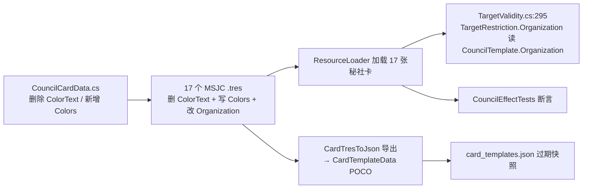

## 产品概述
对一个 Godot 卡牌工程（UWPro）中两类卡资源做一次"格式审计 + 数据纠错"：遍历 `Cards/Data/CouncilCards`（秘社卡，17 个 .tres）与 `Cards/Data/PlayerCards`（玩家卡，729 个 .tres），解析 Godot 4.x `.tres` 的资源/子资源结构，逐字段比对命名、类型与语义，揪出秘社卡里**语义与玩家卡相同却用了不同字段名/类型**的字段，并按用户口径修正数据与常量代码，最后产出可复核的对照表与风险评估。

## 核心范围与要求
1. **全量解析比对**：17 张秘社卡 × 729 张玩家卡的 `[resource]` 顶层字段与 `[sub_resource]` 结构，逐一比对字段名、数据类型、语义。判据为"语义相同必须同名"，不要求字段集合完全一致。
2. **必修项一（ColorText 拆分）**：秘社卡 `ColorText`（如 `"黄·帷幕守望"`）用一个字符串同时承载颜色与阵营，违反单一职责且与玩家卡口径不符。拆分为与玩家卡完全同名的两个字段：颜色 → `Colors`，阵营 → `Organization`。
3. **必修项二（Organization 纠错）**：秘社卡 `Organization` 取自错误数据（`Organization = CardName` 的生成规则），需按第 1 条拆分结果重取正确阵营值；MSJC009 因 ColorText 无"·"段，按用户确认取 `"中立"`。
4. **彻底清理**：`ColorText` 字段本身及其全部代码/数据/文档引用一次性删除，不留双写。

## 已确认口径（用户选择）
- MSJC010~017 的 `Organization` 取 ColorText 后半段（母派系）：010→帷幕守望、011→猎魔人、012→王座会、013→鸣钟教派、014→国家机构、015→圣贤、016→方碑序列、017→梦境行者。
- MSJC009「秘社」：`Colors = Array[int]([0])`（Brown/中立）、`Organization = "中立"`。
- `ColorText` 彻底删除：类属性、JSON 导出、POCO 协议、单测断言、相关 md 文档全部同步。

## 交付物形态
- 代码与数据：C# 数据类、17 个 .tres、导出工具、POCO、单测、过期 JSON 产物、4 份 md 文档。
- 书面产出：新建 `秘社卡TRES字段修正对照.md`，含①不合规字段清单（原字段名/原值/问题/修正字段名/修正值）②17 张逐卡修正对照表③影响范围与风险等级评估。

## 技术栈与现状锚点
- Godot 4.7.1 + Mono/C# 工程，根目录 `d:/MYPROJECT/UWPro`（res:// 即此目录）。
- 卡牌静态数据以 `[GlobalClass] : Resource` + `[Export]` 属性的形式序列化为 `.tres`（format=3），由 `ResourceLoader.Load<T>()` 运行时加载。
- 数据基类：`Script/Data/Cards/BaseCardData.cs`（UID / CardName / Score）→ `PlayerCardData` 与 `CouncilCardData` 两条分支；秘社卡每张再由一个 `Cards/Script/CouncilCards/JC/MSJC0NN_*.cs` 子类脚本在构造函数里填充效果（不落盘）。
- 枚举：`Script/Enums/Enums.cs` 中 `CardColor { Brown=0, Yellow=1, White=2, Green=3, Gray=4, Purple=5, Blue=6, Black=7, Red=8 }`。
- 玩家卡 .tres 的颜色写法为 `Colors = Array[int]([1])`（`Array<CardColor>` 的 Godot 序列化形式），秘社卡必须照抄同一形式。

## 实测结论：唯一真正冲突的字段只有 2 个（其余为观察项，不改）
| 语义 | 玩家卡 | 秘社卡现状 | 处置 |
|---|---|---|---|
| 颜色 | `Colors` : `Array[CardColor]`，写作 `Colors = Array[int]([1])` | `ColorText` : string，复合"色·阵营" | 拆分：删 `ColorText`，新增 `Colors` |
| 阵营 | `Organization` : string | `Organization` : string（同名），但 MSJC009~017 取值错误 | 按 ColorText 后半段重取 |

- **证据链**：ColorText 后半段的 8 个阵营名（帷幕守望/猎魔人/王座会/鸣钟教派/国家机构/圣贤/方碑序列/梦境行者）**全部**出现在玩家卡 `Organization` 取值集合中（梦境行者有 65 张玩家卡）；反之"貘组/哨兵/隐士/颂亡者/梦魇族群/S．P．T执行部/计时者/爱弗罗德家族"在 729 张玩家卡中 **0 匹配**。且按 Organization 分组统计 Colors 主流值得到自洽映射：帷幕守望→1、猎魔人→3、王座会→6、鸣钟教派→8、国家机构→4、圣贤→2、方碑序列→7、梦境行者→5、中立→0。
- **错误数据源已定位**：`秘社制作交接提示词.md` 第 31 行的生成规则 `Organization = CardName`，对 001~008 恰好无副作用，对 009~017 产生 9 处错误值。
- **观察项（本次不改）**：秘社独有语义字段（StartingHandSize / Restrictions / CardText / CardImagePath / ColorIdentity / Layout / Side / PT / TableRow / DrawFromBottom / MainType / SubType / RelatedCardUID）；玩家卡独有且秘社不适用字段（SubCardName / UniqueField / CategoryFlag / SubCategories / MagicDomains / Investigation / Strength / Power / FirstStrike* / Defense / ExtraCost* / AllowedTargets / TargetRequirement / LimitToActionPhaseOnly / PlayableFromGraveyard）；近似但保留现状（SubType vs SubCategories、MainType vs CategoryFlag）。列入交付文档说明，不产生代码变更。

## 实现方案
1. **数据类改契约**：`CouncilCardData` 删除 `[Export] string ColorText`，新增与 `PlayerCardData` 同签名、同默认值的 `[Export] Array<CardColor> Colors`（默认 `{ Brown }`，与玩家卡一致，保证未显式写 `Colors` 的旧 .tres 退化为中立而非 null）。若选择 `Godot.Collections.Array<CardColor>` 写法亦可，但必须与 PlayerCardData 保持同一写法（文件顶部已 `using Godot.Collections;`，`Array<>` 即同一类型）。
2. **17 个 .tres 数据重写**：删除 `ColorText = "..."` 行并在原位置写入 `Colors = Array[int]([N])`；同时改写 `Organization = "..."` 的值。保持行位置、缩进、其余字段（含 `metadata/_custom_type_script`、子资源 id、`ext_resource` 块、多行 `CardText`）完全不动，diff 最小化。
3. **导出链路同步**：`CardTresToJson.ScanCouncilDir` 删除 `ColorText =` 赋值、改为遍历 `template.Colors` 填入 POCO 的通用 `List<string> Colors`（复用通用段，避免 POCO 再出现第二个同语义字段）；`CardTemplateData.cs` 删除 Council 段的 `public string ColorText;`。
4. **单测同步**：`CouncilEffectTests.cs:61` 断言改为校验 `tmpl.Colors` 含 `CardColor.Yellow`；第 64 行 `Organization == "帷幕守望"` 无需改动（修正后仍成立）。
5. **产物与文档**：`Cards/card_templates.json` 为过期导出快照（1.25 MB，含 701 处 ColorText，仓库内**无运行时加载方**，无 ServerCore 消费方），删除其中的 `"ColorText"` 行或整体重新导出；4 份 md 中的 `ColorText` 表述与 `Organization = CardName` 错误规则同步更正，避免后续批次照抄错误口径。

## 影响链路

## 风险评估（已查证全部引用点）
| 引用点 | 现状 | 风险等级 |
|---|---|---|
| `Script/Tests/CouncilEffectTests.cs:61` | 唯一断言 `ColorText` 的测试，不同步改必挂 | 高（必须同批修改） |
| Godot 资源导入 | 若 .tres 仍保留 `ColorText` 而类已删属性 → 导入告警/未知属性被丢弃；反向（类先改、tres 后改）无崩溃 | 中（按顺序一次改完，改完在编辑器/headless 复导一次） |
| `Script/Manager/TargetValidity.cs:295` | `t.PlayerTemplate?.Organization ?? t.CouncilTemplate?.Organization` 是秘社 Organization 的唯一运行时消费方；实测 `Cards/Script/**` 中无任何卡牌效果对秘社模板使用 `TargetRestriction.Organization` ⇒ 当前零行为变化；改为母派系后反而能匹配到真实玩家卡 | 低（正向收益） |
| `DeckSearchFilter.cs:92~100`、`CostModFilter.cs`、`TurnManager` 费用修正 | 仅消费 `PlayerCardData`，不读 CouncilTemplate | 无 |
| `CardTresToJson` / `CardTemplateData` POCO | JSON 协议字段增减；本仓库无 ServerCore 消费方 | 低 |
| `Cards/card_templates.json` | 过期快照，无加载方 | 低（可不改，建议同步） |
| md 文档 4 份 | 仅口径描述 | 低（不改会导致下批次照抄错误规则） |
| `packages/godotsharp/**` | NuGet 包内同名 XML 文档，禁止改动 | 无（排除） |

## 执行要点（防回归）
- 先改 C# 数据类，再改 17 个 .tres，最后改导出/POCO/单测，避免"类无此属但 tres 有此行"的中间态长时间存在。
- 多行 `CardText` 用正则处理时务必使用单行模式逐字段替换，禁止整文件重写，防止 FAQ/换行/全角句号（`S．P．T执行部`）被破坏。
- 改完执行：全仓库检索 `ColorText` 应仅剩 `packages/`（NuGet）与 `Cards/card_templates.json`（若选择不重建）；随后编译 + 跑 CouncilEffectTests / P5CouncilRestrictionTests（后者大量 `ResourceLoader.Load<CouncilCardData>(CouncilDir + ...)` 直接读这 17 个文件，是最好的回归探针）。

## Agent Extensions
- **code-explorer**
  - 用途：在落地阶段复核 `ColorText` / `Organization` 的全部残留引用点（含 Scenes/UI 脚本、.uid 关联、尚未扫描到的 Cards/Efffects 侧代码），确认零遗漏。
  - 预期产出：一份"残留引用 = 0（除 NuGet 与过期 JSON）"的复核清单，作为收尾验收依据。
